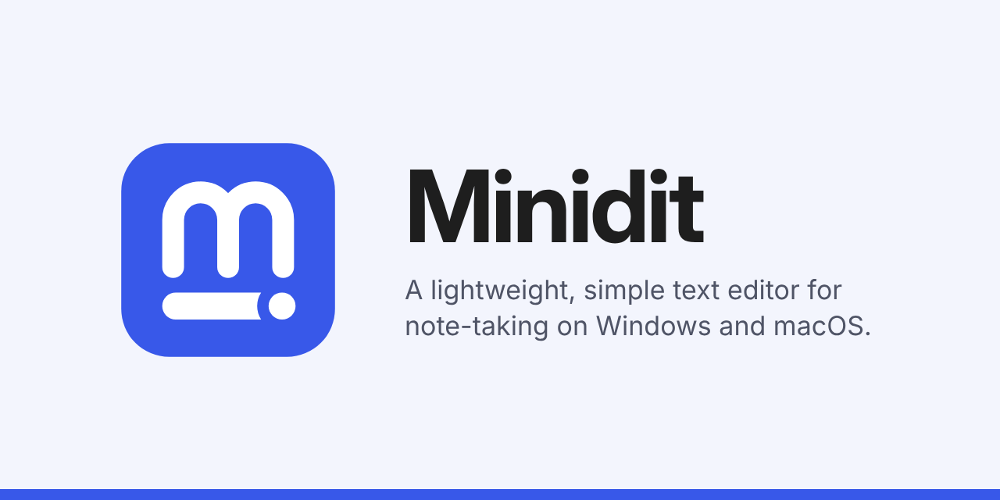

# Minidit

A lightweight, simple text editor for note-taking on Windows and macOS.

Minidit keeps the simplicity of Windows Notepad while adding a few conveniences such as tabs, encoding detection, and regex search. See the [specification](https://github.com/t-hamano/minidit/issues/1) and the [implementation roadmap](https://github.com/t-hamano/minidit/issues/2).

> [!NOTE]
> Minidit is under early development and is not ready for use yet.

## Installation

Download the installer for your OS from the [Releases page](https://github.com/t-hamano/minidit/releases).

- **macOS**: Open the `.dmg` file and drag Minidit to the Applications folder. The app is signed and notarized by Apple.
- **Windows**: Run the `-setup.exe` installer.

Minidit checks for updates at startup and offers to install them. You can turn this off in the settings, and check manually from About Minidit.

### Windows SmartScreen warning

The Windows installer is not code signed, so Microsoft Defender SmartScreen may show "Windows protected your PC" when you run it. To continue, click **More info**, then **Run anyway**. Only do this for installers downloaded from the Releases page of this repository.

## Development

### Requirements

- Node.js (see [`.nvmrc`](.nvmrc)) and [pnpm](https://pnpm.io/)
- Rust (stable)
- The [Tauri prerequisites](https://tauri.app/start/prerequisites/) for your OS

### Commands

```sh
pnpm install       # Install dependencies
pnpm tauri dev     # Run the app in development mode
pnpm tauri build   # Build the app and installers
pnpm lint          # Lint JS and CSS
pnpm format        # Format files with Prettier
pnpm type-check    # Type check TypeScript
```

### Releasing

1. Update the version in `package.json`, `src-tauri/Cargo.toml`, and `src-tauri/tauri.conf.json`, and merge the change.
2. Push a tag such as `v0.1.0` for that version. The Release workflow builds the installers and creates a draft release.
3. Publish the draft release. Installed apps find the update once it is published.

The Release workflow needs these repository secrets:

- `TAURI_SIGNING_PRIVATE_KEY` and `TAURI_SIGNING_PRIVATE_KEY_PASSWORD`: the key that signs updates, created with `pnpm tauri signer generate`. Its public key is in `src-tauri/tauri.conf.json`.
- `APPLE_CERTIFICATE`, `APPLE_CERTIFICATE_PASSWORD`, `APPLE_SIGNING_IDENTITY`, `APPLE_ID`, `APPLE_PASSWORD`, and `APPLE_TEAM_ID`: for signing and notarizing the macOS app.

## License

[GPL-2.0-or-later](LICENSE)
